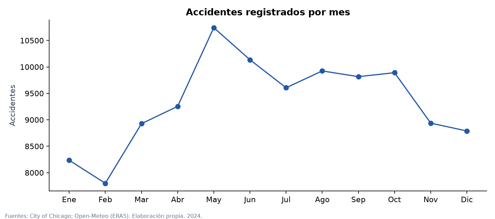
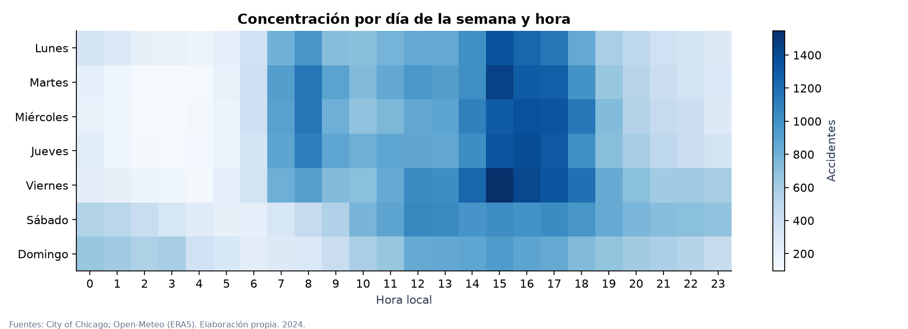
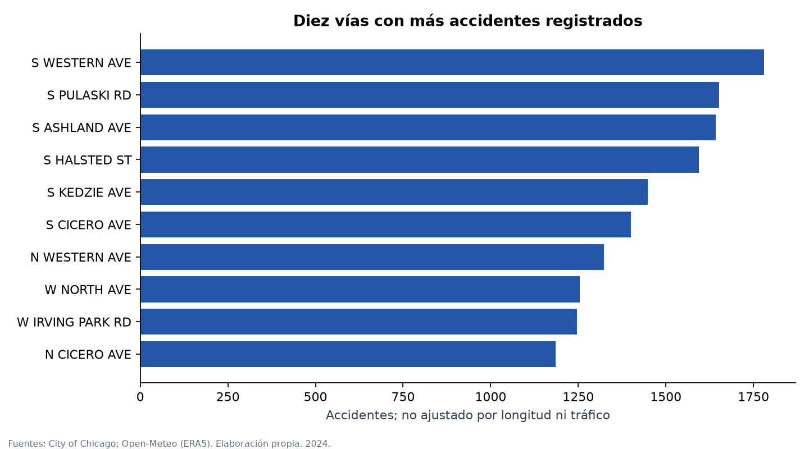
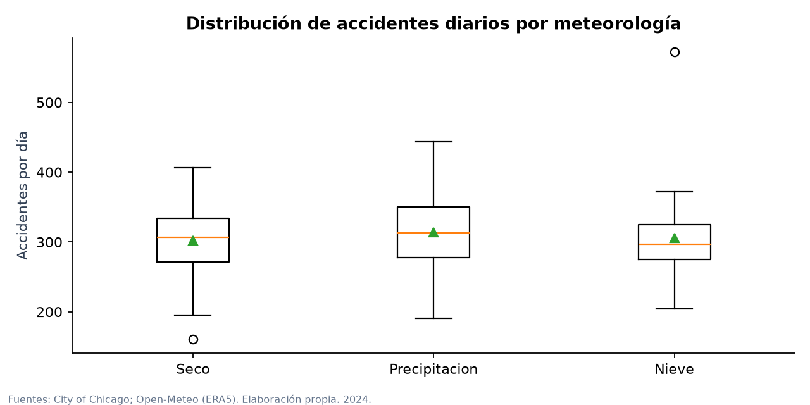
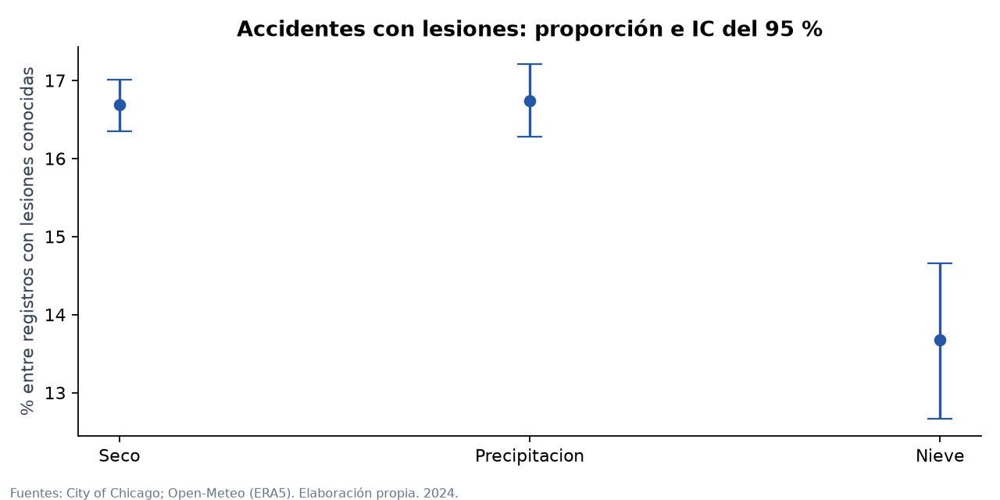

# Seguridad vial en Chicago: accidentes y meteorología diaria

Periodo: 1 de enero a 31 de diciembre de 2024. Proyecto final de Análisis de Datos, ThePower.

## 1. Resumen ejecutivo

El análisis integra **112.057 accidentes y 55 variables** a partir de dos proveedores independientes: City of Chicago y Open-Meteo. Cada accidente se relaciona con las condiciones meteorológicas de su día local. El objetivo es describir patrones de siniestralidad y estudiar asociaciones que puedan orientar revisiones de seguridad vial.

Se registran 18.443 accidentes con lesiones: **16,50 %** de los 111.808 registros con información conocida. Se contabilizan 25.706 personas con lesiones, incluidas 123 personas fallecidas. Son cifras registradas por el proveedor, no estimaciones de todos los accidentes ocurridos.

Los días con precipitación presentan una media bruta ligeramente superior a los secos, pero el modelo ajustado no aporta evidencia clara de una diferencia. Para los días con nieve aparece una asociación positiva con los recuentos ajustados, con solo 25 días observados. Ninguno de estos resultados demuestra causalidad ni riesgo por vehículo.

## 2. Objetivo y preguntas

Pregunta principal: ¿cómo varían la frecuencia y la gravedad registrada de los accidentes de Chicago según el calendario y las condiciones meteorológicas diarias?

- Identificar meses, horas y días de la semana que concentran accidentes.
- Localizar vías con más accidentes registrados, sin confundir volumen con riesgo.
- Comparar recuentos diarios y proporciones con lesiones entre grupos meteorológicos.
- Construir un dashboard operativo y un proceso de análisis reproducible.

El destinatario hipotético es un equipo municipal que necesita priorizar análisis e inspecciones. No se pretende diseñar una intervención causal ni un sistema de predicción.

## 3. Fuentes, alcance y unión

**City of Chicago, Traffic Crashes - Crashes.** Se descargan los registros con crash_date en 2024. La fuente proporciona 49 columnas; se conservan 36 campos originales relevantes y se añaden variables temporales, indicadores y meteorología. El alcance corresponde a incidentes registrados bajo jurisdicción del Chicago Police Department; no cubre necesariamente todos los siniestros dentro de la ciudad. Parte de los partes son declaraciones posteriores y las condiciones descritas por agentes pueden contener errores. El proveedor puede revisar registros históricos.

**Open-Meteo, Historical Weather API, modelo ERA5.** Se descargan 366 registros diarios y ocho variables meteorológicas. Punto solicitado: latitud 41,8781, longitud -87,6298. La respuesta sitúa la cuadrícula en 42,0 y -87,75 (elevación informada 241 m). Es una aproximación espacial de reanálisis, no una estación situada en cada accidente. La zona horaria es America/Chicago. Se conservan la respuesta JSON original, una exportación CSV fiel de sus valores diarios en data/raw y una tabla CSV procesada. La exportación solo cambia el formato; sus unidades y huellas constan en exportacion_csv_meteo.json.

La unión usa la fecha local del accidente y una relación **muchos a uno**. La meteorología tiene una clave única por día. Se comprueba que no hay accidentes sin correspondencia y que el número de filas no aumenta. El resultado contiene 112.057 filas y 55 columnas, por encima del mínimo de 50.000 y 20.

La fecha exacta de descarga y las URL completas constan en data/raw/manifest.json (2026-10-05T20:26:37.547617+00:00). El archivo incluye huellas SHA-256 para comprobar que los originales siguen intactos.

## 4. Limpieza y transformaciones

Se conserva data/raw sin editar y se generan resultados separados en data/processed. Las reglas se implementan en src/analisis.py.

1. Se recortan espacios y normalizan cadenas vacías. Los códigos Y/N se convierten a Sí/No y las ausencias se mantienen como «No consta».
2. Se comprueban fechas, identificadores y duplicados. No se encuentran duplicados exactos ni se excluyen registros por fecha o identificador. Una clave repetida con contenido distinto detendría el proceso para revisión.
3. Se tipifican cantidades y coordenadas. Los recuentos negativos se marcarían como ausentes; no se detectan. Se verifica que las categorías de lesiones suman injuries_total: no hay discrepancias en registros comparables.
4. Se marcan como ausentes 194 límites de velocidad que no están entre 1 y 100 mph. Es una regla de plausibilidad documentada, no una afirmación sobre la normativa. El original conserva los valores. La velocidad no se usa en el modelo meteorológico.
5. Se detectan 7 pares de coordenadas ausentes o fuera de una envolvente amplia de Chicago. Se conservan los accidentes para el análisis temporal y se dejan las coordenadas ausentes. La envolvente no equivale al límite administrativo.
6. Los 249 registros sin injuries_total se conservan. No se imputan como cero; no entran en el denominador del porcentaje con lesiones. Los totales de personas suman solo lo informado.
7. Se derivan fecha, mes, hora, día de la semana, vía e indicadores de lesiones. Se recalcula el día de semana con lunes=0 para evitar confundirlo con la codificación del proveedor. Los avisos policiales se revisan por diferencias temporales negativas; no se detectan.
8. La categoría del día es Nieve si snowfall_sum es al menos 0,1 cm; en los demás días, Precipitacion si precipitation_sum es al menos 1 mm; el resto es Seco. «Seco» admite trazas inferiores al umbral. Son grupos del día completo, no del instante del accidente.

No se eliminan automáticamente extremos meteorológicos ni accidentes con muchas lesiones: pueden representar episodios reales. Las distribuciones, nulos y percentiles se guardan en reports/tables. El diccionario documenta las 55 variables y sus fuentes. Los límites de velocidad originales están en mph; temperatura en °C, precipitación en mm, nieve en cm y viento en km/h.

## 5. Análisis descriptivo

El mes con mayor volumen es mayo y la hora con mayor número de registros es la franja que comienza a las 15:00. Esto describe concentración de registros y puede reflejar exposición al tráfico. No permite afirmar que esa hora sea más peligrosa por viaje.

S WESTERN AVE encabeza las vías por número anual de accidentes. Los nombres incluyen la dirección para no mezclar, por ejemplo, tramos norte y sur. Las vías tienen longitudes y volúmenes de tráfico diferentes; la clasificación es una lista de carga registrada, no una clasificación de riesgo.

### Comparación meteorológica

| Día meteorológico | Días | Accidentes | Accidentes/día | Con lesiones (%) |
|---|---:|---:|---:|---:|
| Seco | 232 | 70.191 | 302,5 | 16,69 |
| Precipitacion | 109 | 34.216 | 313,9 | 16,74 |
| Nieve | 25 | 7.650 | 306,0 | 13,68 |

El porcentaje con lesiones usa como denominador accidentes con injuries_total conocido. Los recuentos por día se calculan con todos los días del calendario de cada categoría. Se evita comparar solo totales de grupos con duraciones muy distintas.

## 6. Análisis estadístico

La unidad de observación para la meteorología es el **día (n=366)**. Los accidentes comparten condiciones diarias, por lo que no se utilizan 112.057 observaciones como si fueran exposiciones meteorológicas independientes.

### Comparaciones exploratorias

Kruskal-Wallis compara las distribuciones de recuentos diarios de los tres grupos: H=4,375, p=0,112. No se rechaza la igualdad de distribuciones a un nivel del 5 %. No es una prueba de equivalencia ni demuestra ausencia de relación.

La correlación de Spearman entre precipitación y accidentes diarios es 0,137, débil y positiva, con p ajustada de 0,017. Se aplica Holm a estas dos pruebas exploratorias. Sus valores p presuponen observaciones independientes y pueden verse afectados por dependencia temporal; se consideran orientativos. La precipitación incluye equivalente en agua de nieve.

### Modelo de recuentos ajustado

Se ajusta un GLM de Poisson con enlace logarítmico: accidentes diarios en función del grupo meteorológico, mes, día de la semana, temperatura media y viento máximo. Se estiman errores robustos HAC con siete retardos para atender sobredispersión y dependencia temporal. No se ajusta por tráfico, porque no se dispone de ese denominador. No se utiliza como modelo predictivo.

La dispersión de Pearson es 4,85, superior a uno, y la autocorrelación de residuos a un día es 0,27. Esto justifica no usar sin más los errores estándar clásicos de Poisson. El ajuste converge. La robustez de la covarianza no corrige omisiones de variables ni una forma funcional incorrecta.

| Comparación frente a Seco | Razón ajustada de recuentos | IC 95 % | p ajustada (Holm) |
|---|---:|---|---:|
| Precipitacion | 1,012 | 0,981 a 1,043 | 0,456 |
| Nieve | 1,126 | 1,026 a 1,237 | 0,026 |

La razón para precipitación equivale aproximadamente a un 1,2 % más de recuentos, pero su intervalo incluye 1: la diferencia no es clara tras el ajuste. Para nieve, la asociación equivale aproximadamente a un 12,6 % más, condicionada al modelo. Los intervalos son individuales del 95 %; las p de las dos comparaciones meteorológicas se corrigen por Holm.

Se repite el ajuste con tres y catorce retardos y con umbral de precipitación de 0,1 mm. La dirección de las asociaciones se mantiene y la conclusión sobre precipitación no cambia. La tabla completa está en reports/tables/sensibilidad.csv. Solo hay 25 días con nieve y su distribución estacional limita las comparaciones a condiciones realmente observadas.

### Lesiones e incertidumbre

La diferencia de proporciones Precipitacion menos Seco es **0,05 puntos porcentuales**. Un bootstrap de 5.000 muestras, remuestreando días dentro de cada grupo, produce un intervalo del 95 % de -0,51 a 0,62 puntos. Como sensibilidad a la dependencia temporal se remuestrean bloques circulares de siete días (3.000 muestras): intervalo de -0,53 a 0,61 puntos. Ambos contienen cero. La semilla es 2024.

El remuestreo por bloques solo aproxima la dependencia local y presupone cierta estabilidad de la serie; un año con marcada estacionalidad limita esta inferencia. No se concluye equivalencia exacta entre grupos.

## 7. Dashboard operativo

dashboard/Dashboard_Chicago_2024.xlsx contiene filtros de mes y categoría meteorológica, indicadores, cuatro gráficos editables y una tabla de diez vías. Los indicadores son accidentes, personas con lesiones, proporción de accidentes con lesiones y accidentes por día. La lista de vías corresponde al top diez anual; sus cifras se filtran, pero no se presenta como un ranking recalculado.

El Excel utiliza resúmenes aditivos de todos los registros del CSV final. Las dimensiones son vistas alternativas y no se suman entre sí. Las fórmulas y gráficos responden a los selectores. Calculos permite seguir los numeradores y denominadores; Datos contiene los resúmenes; Guia explica el uso y la actualización. No requiere macros.

## 8. Conclusiones y aplicación

- Priorizar revisiones de las vías y franjas con mayor carga registrada, contrastándolas después con aforos, longitud de vía y contexto local. Una calle extensa puede acumular más incidentes sin tener una tasa mayor.
- Mantener la nieve como línea de investigación y vigilancia operacional. La asociación ajustada merece contraste con varios inviernos, tráfico y meteorología de mayor resolución antes de justificar intervenciones específicas.
- No sostener que la lluvia aumenta el riesgo individual: el resultado ajustado para precipitación es incierto y falta el volumen de circulación.
- Incorporar al seguimiento una revisión de datos ausentes y de las definiciones de lesiones. Una diferencia en cómo se registra un campo puede alterar un indicador.

## 9. Limitaciones y próximos pasos

El análisis es observacional, de una ciudad y un año. Los partes tienen posibles errores y revisiones, cobertura institucional limitada y sesgos de notificación. Un único punto de reanálisis representa toda la ciudad; puede haber diferencias locales y horarias importantes. Las categorías diarias pueden incluir horas secas durante un día lluvioso.

No se dispone de tráfico, kilómetros recorridos, longitud de vía, obras, eventos ni todos los posibles factores de confusión. Las asociaciones no demuestran causas. El calendario se ajusta mediante mes y día de semana, sin tratar festivos específicos; la meteorología se aproxima con temperatura y viento, y los umbrales simplifican variables continuas. La proporción de lesiones no ajusta por composición de accidentes y puede verse afectada por datos desconocidos.

Los pasos siguientes serían añadir aforos, repetir en varios años, incorporar cuadrículas y horas de meteorología, comparar modelos alternativos y evaluar estabilidad fuera del periodo. Estas ampliaciones no forman parte de los resultados entregados.

## 10. Fuentes y atribución

- City of Chicago. [Traffic Crashes - Crashes](https://data.cityofchicago.org/Transportation/Traffic-Crashes-Crashes/85ca-t3if). Descripciones de variables conservadas en chicago_metadata.json. [Alcance de la fuente](https://catalog.data.gov/dataset/traffic-crashes-crashes).
- [Weather data by Open-Meteo.com](https://open-meteo.com/), modelo ERA5, Copernicus Climate Change Service. [API histórica](https://open-meteo.com/en/docs/historical-weather-api) y [licencia CC BY 4.0](https://open-meteo.com/en/licence). Se han realizado unión, categorización y agregación.
- Las definiciones originales de Chicago se mantienen en el diccionario; la selección de variables y las reglas analíticas son propias del proyecto. Ningún proveedor avala las conclusiones.
